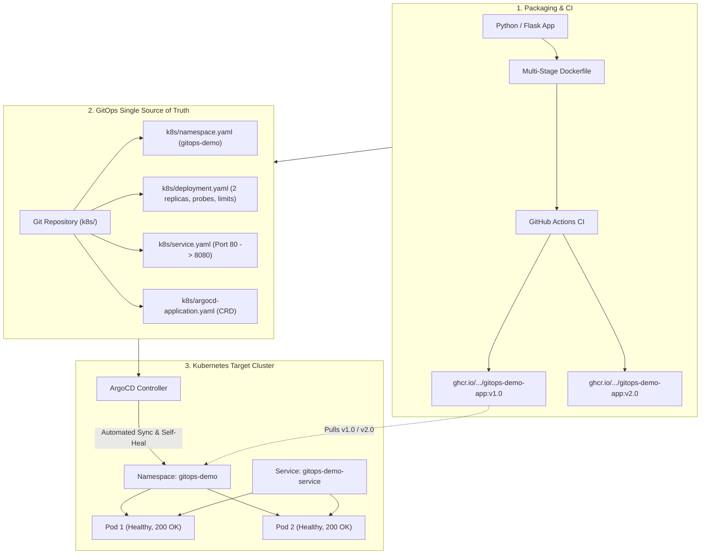

# GitOps Microservice: Application Packaging & Kubernetes Manifests

[](https://github.com/Raunakg2005/gitops-demo-app/actions/workflows/docker-publish.yml)
[](LICENSE)
[](k8s/)
[](k8s/argocd-application.yaml)

A production-grade, lightweight web microservice with dynamic version badging, optimized multi-stage container packaging, and declarative Kubernetes manifests designed for continuous delivery with **ArgoCD GitOps**.

---

## 🎯 Deliverables & Quick Links

| Deliverable | Location / URL | Description |
| :--- | :--- | :--- |
| **GitHub Repository** | [Raunakg2005/gitops-demo-app](https://github.com/Raunakg2005/gitops-demo-app) | Clean source code, Dockerfile, CI pipeline & manifests |
| **Public Container Image (v1.0)** | `ghcr.io/raunakg2005/gitops-demo-app:v1.0` | Production Stable Release (Emerald badge) |
| **Public Container Image (v2.0)** | `ghcr.io/raunakg2005/gitops-demo-app:v2.0` | Feature Release (Electric Violet badge) |
| **Kubernetes Manifests** | [`/k8s`](k8s/) | Namespace, Deployment (2 replicas, probes, resources), Service, ArgoCD Application |

---

## 🏗️ Architecture & GitOps Flow



---

## 📂 Repository Structure

```
├── .github/
│   └── workflows/
│       └── docker-publish.yml    # CI/CD: Automated multi-arch build & publish to GHCR
├── app/
│   ├── app.py                    # Lightweight web application (/health, /, /api/info)
│   ├── requirements.txt          # Minimal Python dependencies (Flask, Gunicorn)
│   └── templates/
│       └── index.html            # High-aesthetic dark mode dashboard with version badge
├── k8s/
│   ├── namespace.yaml            # Dedicated namespace 'gitops-demo'
│   ├── deployment.yaml           # 2 replicas, resource limits, readiness & liveness probes
│   ├── service.yaml              # NodePort/ClusterIP service mapping port 80 -> 8080
│   ├── kustomization.yaml        # Kustomize manifest for GitOps image tag updates
│   └── argocd-application.yaml   # ArgoCD Application CRD for 1-click sync
├── .dockerignore                 # Exclusions to minimize container context
├── .gitignore                    # Git exclusions
├── Dockerfile                    # Multi-stage build with non-root security context
└── README.md                     # Documentation and verification guide
```

---

## 💡 Application Features

1. **Prominent Version Badges**:
   - `v1.0`: Emerald Green badge (**v1.0 • Production Stable**).
   - `v2.0`: Electric Violet badge (**v2.0 • Feature Release**).
   - Allows instant visual confirmation of zero-downtime rolling updates in ArgoCD.
2. **Kubernetes Downward API Telemetry**:
   - Live pod name, pod namespace, pod IP, node name, and server uptime.
3. **Health & Probes Endpoints**:
   - `GET /health`: Returns HTTP 200 OK with JSON:
     ```json
     {
       "status": "healthy",
       "version": "v1.0",
       "pod_name": "gitops-demo-app-7798c8c5c-abcde",
       "namespace": "gitops-demo",
       "uptime_seconds": 124.5,
       "timestamp": "2026-09-22T04:00:00Z"
     }
     ```
   - `GET /api/info`: Machine-readable metadata endpoint.
4. **Security Hardening**:
   - Runs as non-root user `appuser` (`UID 10001: GID 10001`).
   - Privilege escalation disabled, capabilities dropped.

---

## 🐳 Dockerization & Multi-Stage Build

The container is built using a secure multi-stage `Dockerfile`:
- **Stage 1 (`builder`)**: Uses `python:3.12-slim` to compile wheels inside `/opt/venv`, avoiding build tool accumulation in the runtime image.
- **Stage 2 (`runner`)**: Copies only the virtual environment and application files onto a clean `python:3.12-slim` base with a dedicated non-root user (`appuser`).
- **Production Server**: Runs with `gunicorn` (2 workers) on port `8080`.
- **Image Footprint**: < 80MB.

### Building & Running Locally with Docker:

```bash
# Build v1.0
docker build --build-arg APP_VERSION=v1.0 -t gitops-demo-app:v1.0 .

# Build v2.0
docker build --build-arg APP_VERSION=v2.0 -t gitops-demo-app:v2.0 .

# Run container locally
docker run -d -p 8080:8080 --name demo-v1 gitops-demo-app:v1.0

# Verify health endpoint
curl http://localhost:8080/health
```

---

## ☸️ Kubernetes Declarative Manifests

### 1. `namespace.yaml`
Isolates resources inside the dedicated `gitops-demo` namespace:
```yaml
apiVersion: v1
kind: Namespace
metadata:
  name: gitops-demo
  labels:
    name: gitops-demo
    app.kubernetes.io/managed-by: argocd
```

### 2. `deployment.yaml`
Key highlights:
- **Replicas**: 2 (ensures high availability)
- **Zero-Downtime Rolling Update**: `maxSurge: 1`, `maxUnavailable: 0`
- **Resource Requests & Limits**:
  - `requests`: CPU `50m`, Memory `64Mi`
  - `limits`: CPU `150m`, Memory `128Mi`
- **Probes**:
  - `readinessProbe`: `GET /health` on port `8080` (`initialDelaySeconds: 5`, `periodSeconds: 10`)
  - `livenessProbe`: `GET /health` on port `8080` (`initialDelaySeconds: 10`, `periodSeconds: 15`)
- **Security Context**: `runAsNonRoot: true`, `runAsUser: 10001`

### 3. `service.yaml`
Exposes the application externally on port `80` (mapped to pod targetPort `8080`):
- `type: NodePort` on `nodePort: 30080` for easy local cluster access (Minikube, kind, Docker Desktop, k3s).
- Can be switched to `ClusterIP` for production cloud ingress.

### 4. `argocd-application.yaml`
Declarative GitOps Custom Resource (CRD):
- Tracks the GitHub repository path `k8s/`.
- Deploys into `gitops-demo` namespace.
- Automated sync policy with `prune: true` and `selfHeal: true`.

---

## 🧪 Verification Instructions

### 1. Local Manifest Dry-Run Verification (`kubectl apply --dry-run=client`)

Run client-side dry-run validation to verify all manifests syntactically and structurally:

```bash
# Validate manifests via kubectl client dry-run:
kubectl apply -f k8s/namespace.yaml -f k8s/deployment.yaml -f k8s/service.yaml --dry-run=client
```

**Expected Output:**
```text
namespace/gitops-demo created (dry run)
deployment.apps/gitops-demo-app created (dry run)
service/gitops-demo-service created (dry run)
```

You can also validate the entire bundle using Kustomize:
```bash
kubectl kustomize k8s/
```

### 2. Deploying to a Kubernetes Cluster

Apply all manifests directly:
```bash
kubectl apply -f k8s/namespace.yaml
kubectl apply -f k8s/deployment.yaml
kubectl apply -f k8s/service.yaml
```

Verify deployment and pod health:
```bash
kubectl get pods -n gitops-demo -o wide
kubectl get svc -n gitops-demo
```

Port-forward to test in browser:
```bash
kubectl port-forward svc/gitops-demo-service 8080:80 -n gitops-demo
```
Visit: `http://localhost:8080`

### 3. ArgoCD GitOps Deployment

Apply the declarative ArgoCD application manifest:
```bash
kubectl apply -f k8s/argocd-application.yaml
```
ArgoCD will automatically detect the repo, sync the manifests, pull the container image, and maintain the desired state.

### 4. Performing a GitOps Version Upgrade (v1.0 -> v2.0)

To trigger an automated zero-downtime rolling update via GitOps:
1. Update `deployment.yaml` (or `kustomization.yaml`) changing `v1.0` to `v2.0`:
   ```yaml
   image: ghcr.io/raunakg2005/gitops-demo-app:v2.0
   ```
2. Commit and push:
   ```bash
   git add k8s/
   git commit -m "feat(k8s): upgrade gitops-demo-app to v2.0"
   git push origin main
   ```
3. ArgoCD detects the commit, pulls `v2.0`, spins up new pods, verifies `/health` probes, and gracefully terminates old pods with zero downtime!

---

## 👥 Authors & Team
- **Track Lead**: Application Packaging & Kubernetes Manifests
- **Repository**: [Raunakg2005/gitops-demo-app](https://github.com/Raunakg2005/gitops-demo-app)
